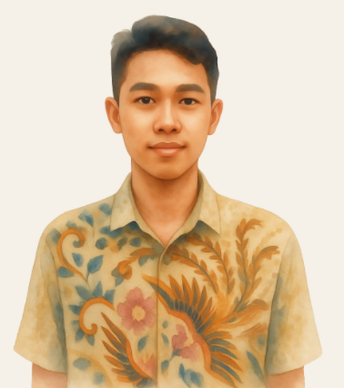

<!-- Opening Section -->
<section class="opening">
  <h1>Selamat Datang 🥳</h1>
    
Hi, People!

    

      Yang teman-teman lihat saat ini adalah <strong>ruang pameran pribadi tanpa batas</strong> yang menampung berbagai ekspresi seniman dalam menyalurkan ide-ide kreatif. Perjuangan melawan <i>overthinking</i> dalam kehidupan sehari-hari telah menginspirasi seniman untuk menciptakan ruang ini. Lebih dari itu, melalui ruang ini, seniman juga berharap dapat memberikan inspirasi tanpa batas kepada siapapun yang mengunjunginya.
    

    
Ayo eksplorasi berbagai koleksi karya di ruang ini! 👇

</section>
  
<!-- Projects Section -->
<section id="projects" class="projects">
  <h2>Karya</h2>  
  <!-- Project Grid -->
  
  
  <!-- Kontainer Projects -->
  

    <!-- Grid -->
    

      
        <article class="project-card" data-index="{{ forloop.index0 }}" itemscope itemtype="https://schema.org/CreativeWork">
          <!--Thumbnail-->
          
          

            
          

          
          <!--Project Content-->
          

            <!--Project Header-->
            

              <h3 class="project-title">
                <a href="{{ project.deck_url }}{{ project.url }}" target="_blank" rel="noopener noreferrer" itemprop="url">
                  {{ project.title }}
                </a>
              </h3>
              <!--Tags-->
              
              

                
                {{ tag }}
                
              

              
            

            <!--Project Summary-->
            

              

                <!--Teks Preview-->
                {{ project.summary | truncate: 200 }}
                Lihat
              

              <!--Full Summary-->
              

                
{{ project.summary }}

                

                  
                  <a href="{{ project.repo_url }}" class="btn btn-secondary" target="_blank">
                    Detail Karya
                  </a>
                  
                  
                  
                    <a href="{{ clean_demo_url }}" class="btn btn-primary" target="_blank">
                      Demo App
                    </a>
                  
                

                <!--Tutup details saat tombol "Tutup" diklik-->
                

                  
                    Tutup
                  
                

              

            

          

        </article>
      
    

  

  <!-- Scroll Progress Dots -->
  

  <!-- Scroll Navigation Buttons -->
  

    <button class="scroll-btn scroll-prev" aria-label="Geser kiri">
      <svg width="32" height="32" viewBox="0 0 24 24" fill="none" stroke="currentColor" stroke-width="3">
        <path d="M15 18l-6-6 6-6"/>
      </svg>
    </button>
    <button class="scroll-btn scroll-next" aria-label="Geser kanan">
      <svg width="32" height="32" viewBox="0 0 24 24" fill="none" stroke="currentColor" stroke-width="3">
        <path d="M9 18l6-6-6-6"/>
      </svg>
    </button>
  

  
  

    <a href="/projects" class="btn">→ Lihat Semua</a>
  

  
</section>

<!-- Profile Section -->
<section id="profile" class="profile">
  <h2>Profil Seniman ~</h2>
  

    <!-- Kolom Teks -->
    

      

        <strong>Anggun Sulis Setyawan</strong> a.k.a <strong>Bang Suwan</strong> atau lebih dikenal sebagai Mas Sul merupakan <i>Data Scientist</i> dengan latar belakang keilmuan <i>Environmental Engineering</i>. Ketertarikannya berada pada persimpangan antara <strong>data</strong>, <strong>sistem</strong>, dan cara manusia memahami serta memanfaatkan <strong>informasi</strong> dalam konteks nyata.
      

      

        Seniman terbiasa bekerja menggunakan beberapa alat seperti <strong>Excel/GSheet</strong>, <strong>Python</strong>, <strong>SQL</strong>, <strong>Looker Studio</strong>, dan <strong>Power BI</strong> serta didukung oleh <strong>AI tools (Claude, ChatGPT, Gemini)</strong> sebagai asistennya. Dalam proses berkarya, seniman tidak sekadar memandang setiap proyek sebagai implementasi teknis, melainkan juga ruang eksplorasi intelektual. Diawali dari perumusan masalah, dilanjutkan dengan pemahaman data dan pola, perancangan solusi, hingga evaluasi dan refleksi pasca-implementasi. Pendekatan ini membentuk pola belajar yang iteratif, kritis, dan berorientasi pada pemahaman mendalam terhadap setiap permasalahan yang dihadapi.
      

      

        Karya-karya yang didokumentasikan dan ditampilkan pada ruang ini tidak hanya merepresentasikan hasil akhir, tetapi juga menampilkan proses berpikir di baliknya. Melalui ruang ini, seniman ingin berbagi wawasan, membuka ruang diskusi, serta mendorong pembelajaran yang berkelanjutan. Seniman selalu terbuka untuk menyambut peluang kolaborasi pengembangan solusi berbasis data dengan berbagai pihak.
      

      <!-- Hashtag -->
      

        <code>#masihbelajar</code>
        <code>#terusbelajar</code> 
        <code>#salingbelajar</code>
      

    

    <!-- Kolom Foto -->
    

      
    

  

</section>
<!-- Kisah Section -->
<section id="kisah" class="kisah-section" aria-labelledby="kisah-heading">
  

    <header class="kisah-header">
      Kronologi Perjalanan
      <h2 id="kisah-heading" class="kisah-title">Kisah ~</h2>
      

        Rekam jejak kronologis seniman dari masa ke masa membawa diri seniman untuk terus tumbuh menjadi lebih baik.
      

    </header>
    <!-- Alur Kisah -->
    <ol class="timeline-vertikal">
      <!-- Agu 2026 - Sekarang: Admin & Facilitator Bootcamp — Halotech Academy -->
      <li class="timeline-item">
        
        <article class="timeline-card">
          

            Agu 2026 - Sekarang
            Pengalaman Kerja/Proyek · Part Time
          

          <h3 class="timeline-heading">Admin &amp; Facilitator Bootcamp — Halotech Academy</h3>
          

            Mengelola administrasi dan database peserta bootcamp Data Analyst menggunakan
            spreadsheet, mengatur jadwal kelas online (Google Classroom, Calendar, Zoom), menyiapkan
            bahan belajar (Canva, Google Classroom, Excel, DBeaver, Google Colab), menyusun laporan
            evaluasi harian/mingguan bersama mentor, serta mendampingi progres peserta lewat
            WhatsApp Group.
          

        </article>
      </li>
      <!-- Feb 2025 - Mei 2025: Non-Class Mentor — DBSF Coding Camp 2025 for SMK -->
      <li class="timeline-item">
        
        <article class="timeline-card">
          

            Feb 2025 - Mei 2025
            Pengalaman Kerja/Proyek · Kontrak
          

          <h3 class="timeline-heading">Non-Class Mentor — DBSF Coding Camp 2025 for SMK</h3>
          

            Membimbing peserta tingkat SMK terkait dasar-dasar machine learning dan soft-skill,
            serta berkolaborasi bersama mentor lain menyusun dan menyelenggarakan sesi berbagi
            santainya untuk mendukung perjalanan belajar peserta.
          

        </article>
      </li>
      <!-- Agu 2019 - Mei 2025: Teknik Lingkungan — Universitas Diponegoro -->
      <li class="timeline-item">
        
        <article class="timeline-card">
          

            Agu 2019 - Mei 2025
            Pendidikan · Sarjana
          

          <h3 class="timeline-heading">Teknik Lingkungan — Universitas Diponegoro</h3>
          

            Menyelesaikan studi Sarjana Teknik Lingkungan (IPK 3,74/4) dengan tugas akhir
            Perencanaan Pengelolaan Air Hujan dengan Penerapan Low Impact Development (LID) Pada
            DAS Bringin Kota Semarang.
          

        </article>
      </li>
      <!-- Des 2024 - Sekarang: External Academy Code Reviewer — Dicoding Indonesia -->
      <li class="timeline-item">
        
        <article class="timeline-card">
          

            Des 2024 - Sekarang
            Pengalaman Kerja/Proyek · Freelance
          

          <h3 class="timeline-heading">External Academy Code Reviewer — Dicoding Indonesia</h3>
          

            Memeriksa dan mengevaluasi tugas proyek siswa pelatihan Machine Learning dan Data
            Science sesuai kriteria serta praktik industri, sekaligus memberikan umpan balik yang
            terstruktur untuk meningkatkan keterampilan dan hasil belajar siswa.
          

        </article>
      </li>
      <!-- Jul 2024 - Des 2024: Machine Learning — DBSF Coding Camp 2024 -->
      <li class="timeline-item">
        
        <article class="timeline-card">
          

            Jul 2024 - Des 2024
            Pengalaman Kerja/Proyek · Proyek Akhir
          

          <h3 class="timeline-heading">Machine Learning — DBSF Coding Camp 2024</h3>
          

            Mengembangkan analisis sentimen NLP kepuasan pengguna aplikasi GoPay, klasifikasi
            gambar sampah kemasan minuman dengan transfer learning CNN, model regresi baseline
            densitas nutrisi makanan berbasis komposisi gizi, serta sistem rekomendasi makanan
            berbasis content-based dan collaborative filtering.
          

        </article>
      </li>
      <!-- Feb 2024 - Jul 2024: Bangkit Academy 2024 (Google, GoTo, Traveloka) -->
      <li class="timeline-item">
        
        <article class="timeline-card">
          

            Feb 2024 - Jul 2024
            Pendidikan dan Pelatihan · Jalur Machine Learning
          

          <h3 class="timeline-heading">Bangkit Academy 2024 (Google, GoTo, Traveloka)</h3>
          

            Mempelajari konsep dan penerapan AI untuk berbagai masalah machine learning melalui
            kelas Analisis Data dengan Python, Matematika untuk Sains Data, Machine Learning
            Specialization, dan TensorFlow Specialization, serta mengembangkan model klasifikasi
            gambar sampah domestik berbasis CNN pada Capstone Project bersama tim.
          

        </article>
      </li>
      <!-- Jan 2024: 10 Besar dari 180 Peserta — Entredibles Academy (Fiksioner Indonesia) -->
      <li class="timeline-item">
        
        <article class="timeline-card">
          

            Jan 2024
            Pencapaian
          

          <h3 class="timeline-heading">10 Besar dari 180 Peserta — Entredibles Academy (Fiksioner Indonesia)</h3>
          

            Meraih posisi 10 besar dari 180 peserta dalam program Entredibles Academy yang
            diselenggarakan oleh Fiksioner Indonesia.
          

        </article>
      </li>
      <!-- Jun 2023 - Okt 2024: Data & Research — WCD Jawa Tengah -->
      <li class="timeline-item">
        
        <article class="timeline-card">
          

            Jun 2023 - Okt 2024
            Pengalaman Kerja/Proyek · Sukarelawan
          

          <h3 class="timeline-heading">Data &amp; Research — WCD Jawa Tengah</h3>
          

            Mengelola dan merapikan database volunteer, mitra (komunitas/instansi), serta arsip
            dokumen World Clean Up Day Jawa Tengah menggunakan spreadsheet dan Google Drive, serta
            menjadi koordinator pengelolaan sampah pada upacara penyambutan mahasiswa baru
            Universitas Diponegoro 2024.
          

        </article>
      </li>
      <!-- Mar 2023 - Jul 2023: Asisten — DLH Kota Salatiga -->
      <li class="timeline-item">
        
        <article class="timeline-card">
          

            Mar 2023 - Jul 2023
            Pengalaman Kerja/Proyek · Proyek Dosen
          

          <h3 class="timeline-heading">Asisten — DLH Kota Salatiga</h3>
          

            Merekapitulasi dan mengolah data kondisi serta kegiatan pengelolaan lingkungan hidup
            Kota Salatiga tahun 2022, dan berkolaborasi dalam tim untuk menyusun laporan Informasi
            Kinerja Pengelolaan Lingkungan Hidup Kota Salatiga tahun 2022.
          

        </article>
      </li>
      <!-- Okt 2022 - Des 2022: Marketing Officer — Harisenin.com -->
      <li class="timeline-item">
        
        <article class="timeline-card">
          

            Okt 2022 - Des 2022
            Pengalaman Kerja/Proyek · Magang
          

          <h3 class="timeline-heading">Marketing Officer — Harisenin.com</h3>
          

            Melakukan riset calon partner kolaborasi dalam penulisan artikel serta menganalisis 3
            platform komunitas kompetitor untuk menyusun rekomendasi strategi pengembangan
            platform komunitas.
          

        </article>
      </li>
      <!-- Agu 2022 - Des 2022: Wirausaha Muda Merdeka — LPIK ITB -->
      <li class="timeline-item">
        
        <article class="timeline-card">
          

            Agu 2022 - Des 2022
            Pendidikan dan Pelatihan · Kewirausahaan
          

          <h3 class="timeline-heading">Wirausaha Muda Merdeka — LPIK ITB</h3>
          

            Berlatih menganalisis rencana bisnis startup EduTech dan memberikan rekomendasi
            pengembangan lanjutan, serta merancang ide bisnis Vendoraya sebagai platform agregator
            yang menghubungkan pelanggan dengan vendor konveksi lokal.
          

        </article>
      </li>
      <!-- Jul 2022 - Sept 2022: Market Research & Analyst — Harisenin.com -->
      <li class="timeline-item">
        
        <article class="timeline-card">
          

            Jul 2022 - Sept 2022
            Pengalaman Kerja/Proyek · Magang
          

          <h3 class="timeline-heading">Market Research &amp; Analyst — Harisenin.com</h3>
          

            Menyusun laporan analisis produk dan layanan 2 kompetitor, mengevaluasi formulir
            pendaftaran customer agar data yang dikumpulkan valid, serta membersihkan, mengolah,
            menganalisis, dan memvisualisasikan data menjadi dashboard karakteristik customer
            selama 6 bulan terakhir.
          

        </article>
      </li>
      <!-- Feb 2022 - Jul 2022: Data Analytics, Product & Marketing — RevoU Academy -->
      <li class="timeline-item">
        
        <article class="timeline-card">
          

            Feb 2022 - Jul 2022
            Pendidikan dan Pelatihan · Studi Independen
          

          <h3 class="timeline-heading">Data Analytics, Product &amp; Marketing — RevoU Academy</h3>
          

            Mengikuti pelatihan studi independen terkait pemahaman bisnis, pembersihan data,
            visualisasi data, pelaporan, serta studi kasus Product Management, Data Analytics,
            Digital Marketing, dan Sales Development—termasuk riset produk fitur GoFood pada
            aplikasi Gojek.
          

        </article>
      </li>
    </ol>
  

</section>
